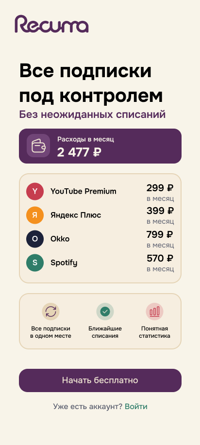
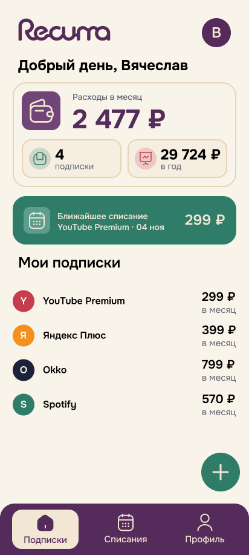
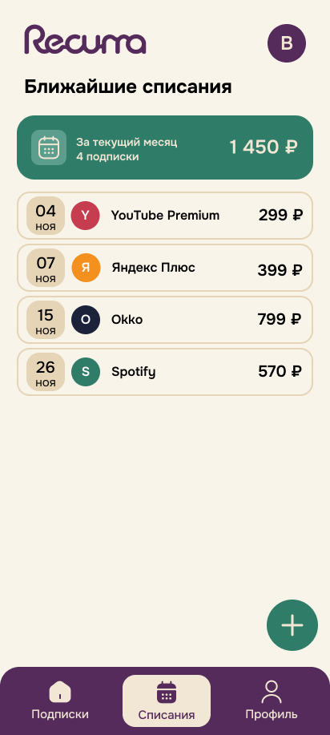
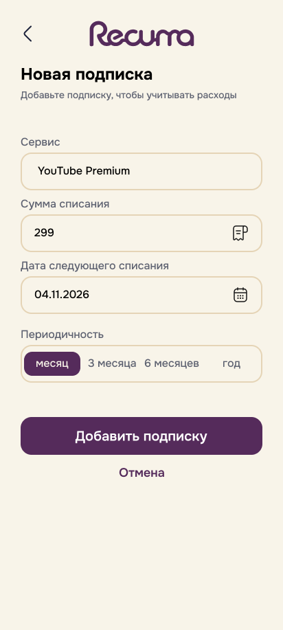
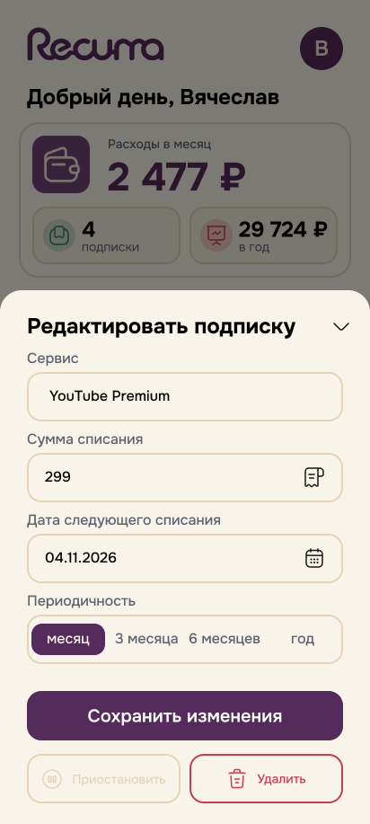

# Recurra

**Recurra** — мобильное Android-приложение для удобного управления подписками и регулярными платежами.

Приложение помогает отслеживать расходы, контролировать даты предстоящих списаний и управлять активными подписками в одном месте.

## Дизайн приложения

  

### Основные экраны

  
  
  

### Управление подписками

  
  

> Представленные изображения — дизайн-макеты приложения.

## Возможности приложения

В рамках проекта предусмотрены:

- Просмотр и управление активными подписками.
- Добавление и редактирование подписок.
- Отслеживание дат предстоящих платежей.
- Просмотр истории списаний.
- Учёт стоимости регулярных платежей.
- Управление подписками через удобный интерфейс.

## Технологический стек

- **Kotlin** — основной язык разработки.
- **Jetpack Compose** — создание пользовательского интерфейса.
- **Material Design 3** — компоненты интерфейса.
- **Gradle Kotlin DSL** — конфигурация сборки.
- **Android Studio** — среда разработки.
- **Git / GitHub** — контроль версий.

Технологический стек будет расширяться по мере разработки проекта.

## Статус проекта

**В разработке.**

Текущий этап — проектирование и реализация пользовательского интерфейса на основе подготовленных дизайн-макетов.

## Автор

**Parzij**

GitHub: [@parzij](https://github.com/parzij)
